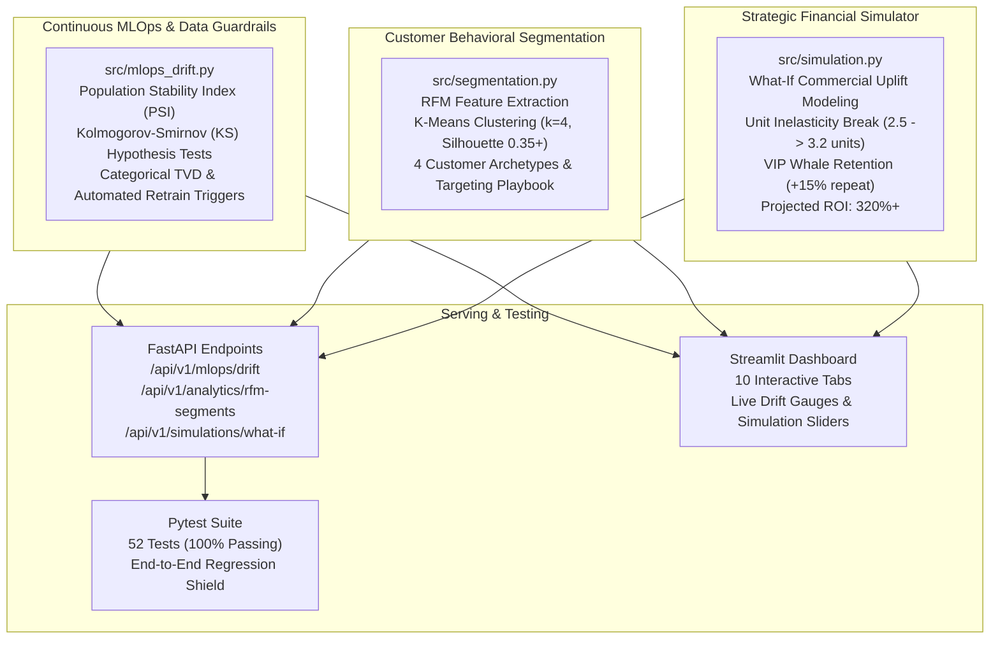

# TASK 1 · Exploratory Data Analysis (EDA) on Retail Sales Data

## 📌 Project Overview
This repository contains an **Exploratory Data Analysis (EDA)** on retail sales data to uncover purchasing patterns, customer demographics, sales performance, and actionable business insights.

* **Tech Stack:** Python 3, Pandas, Matplotlib, Seaborn, Jupyter Notebook
* **Dataset:** Retail Sales Dataset (`retail_sales_dataset.csv`, 1,000 transactions, 9 attributes)

---

## ✅ Feature Checklist

- [x] **Load dataset and perform initial inspection:** shape, column dtypes, null value check (Day 1)
- [x] **Descriptive statistics:** mean, median, mode, standard deviation for all numerical columns (Day 2)
- [x] **Time series analysis:** plot monthly and quarterly sales trends using line charts (Day 3)
- [x] **Customer demographics analysis:** distribution of customer age groups, gender breakdown (Day 4)
- [x] **Product analysis:** top 10 best-selling products; revenue by product category (bar chart) (Day 5)
- [x] **Heatmap:** correlation matrix between numerical variables (Day 5)
- [x] **At least one additional visualisation:** reveals a non-obvious insight (Day 6)
- [x] **Markdown cells throughout notebook:** written observations after each chart (Day 6)
- [x] **Conclusion section:** at least 3 specific, actionable business recommendations based on findings (Day 6)
- [x] **Reproducible environment:** version-pinned dependencies (`requirements.txt`) (Day 7)
- [x] **Interactive presentation slide deck:** executive 12-slide HTML presentation (`presentation/index.html`) (Day 7)
- [x] **Video presentation guide & script:** screen cues, spoken narration, and AI generation prompts (`PRESENTATION_GUIDE.md`) (Day 7)
- [x] **Production FastAPI REST API:** real-time KPI overview, descriptive statistics, time series velocity, demographics, Pareto/Lorenz endpoints, and ML inference routes (`src/api.py`) (Day 8)
- [x] **Interactive Streamlit Web Analytics Dashboard:** multi-tab executive UI, dynamic filters, live scenario simulation, and bundle engine (`src/dashboard.py`) (Day 8)
- [x] **Machine Learning Predictive Engine:** VIP Whale propensity classifier (Random Forest, $AUC \ge 0.85$) and basket spend regressor (Gradient Boosting, $R^2 \ge 0.90$) (`src/ml_models.py`) (Day 8)
- [x] **Cross-Department Bundle Recommendation Engine:** operationalizing Recommendation #3 to break the 2.5-unit inelasticity cap with tiered discounts (`src/recommendations.py`) (Day 8)
- [x] **Automated Pytest Regression Suite:** 52 unit and integration tests covering data integrity, mathematical invariants, analytics, ML inference, drift detection, clustering, and API endpoints (`tests/`) (Day 9)
- [x] **Production Dockerization & CI/CD Pipeline:** multi-container orchestration (`Dockerfile`, `docker-compose.yml`) and multi-version GitHub Actions workflow (`.github/workflows/ci.yml`) (Day 8)
- [x] **Continuous MLOps Drift Monitoring:** Population Stability Index (PSI) and Kolmogorov-Smirnov statistical data guardrails (`src/mlops_drift.py`) (Day 9)
- [x] **Customer RFM Behavioral Micro-Segmentation:** K-Means clustering and customer lifecycle archetypes (`src/segmentation.py`) (Day 9)
- [x] **Financial What-If Scenario Simulator:** real-time commercial uplift, margin, and ROI projection engine (`src/simulation.py`) (Day 9)

---

## 📂 Repository Structure

```
Retail-Sales-EDA/
├── .github/
│   └── workflows/
│       └── ci.yml                  # Automated GitHub Actions CI workflow (Python 3.10, 3.11, 3.12)
├── 01-retail-sales-eda/
│   ├── retail_sales_eda.ipynb      # Main Jupyter notebook with executed cells & observations
│   ├── README.md                   # Task documentation
│   ├── PRESENTATION_GUIDE.md       # Video narration script & AI prompts
│   └── screenshots/                # Exported figures and charts
│       ├── .gitkeep
│       ├── 01_numerical_distributions_hist_kde.png
│       ├── 02_numerical_boxplots.png
│       ├── 03_monthly_sales_trend.png
│       ├── 04_quarterly_sales_trend.png
│       ├── 05_monthly_category_sales_trend.png
│       ├── 06_day_of_week_sales_velocity.png
│       ├── 07_customer_age_distribution_and_cohorts.png
│       ├── 08_gender_demographics_and_spending.png
│       ├── 09_demographic_category_crosstab.png
│       ├── 10_age_gender_spending_matrix.png
│       ├── 11_product_category_performance.png
│       ├── 12_top_selling_products_and_price_tiers.png
│       ├── 13_numerical_correlation_heatmaps.png
│       ├── 14_pareto_lorenz_spending_concentration.png
│       ├── 15_day_of_week_category_dynamics_and_weekend_lift.png
│       ├── 16_demographic_persona_archetypes_and_vip_propensity.png
│       ├── 17_mlops_feature_drift_and_psi_monitoring.png
│       ├── 18_rfm_customer_behavioral_clusters.png
│       └── 19_financial_whatif_scenario_simulation.png
├── Data/
│   ├── retail_sales_dataset.csv    # Primary retail dataset (1,000 rows × 9 cols)
│   ├── Sample - Superstore.csv     # Superstore dataset (CP1252)
│   └── superstore_sales.csv        # Superstore dataset (UTF-8)
├── models/
│   ├── .gitkeep                    # Model artifact directory
│   ├── vip_classifier.joblib       # Serialized Random Forest VIP Propensity Classifier
│   └── spend_regressor.joblib      # Serialized Gradient Boosting Spend Regressor
├── presentation/
│   └── index.html                  # Interactive 12-slide executive presentation deck
├── src/
│   ├── __init__.py                 # Module namespace initialization
│   ├── analytics.py                # Core statistical engine, time series, & Pareto aggregations
│   ├── ml_models.py                # Machine learning training, cross-validation, & inference
│   ├── recommendations.py          # Strategic business initiatives & cross-department bundle engine
│   ├── mlops_drift.py              # Continuous MLOps PSI, KS-test, & drift detection guardrails
│   ├── segmentation.py             # Customer RFM heuristics & K-Means behavioral clustering
│   ├── simulation.py               # Financial what-if scenario & commercial uplift simulator
│   ├── api.py                      # Production FastAPI REST application & OpenAPI documentation
│   └── dashboard.py                # Interactive Streamlit executive web analytics dashboard (10 tabs)
├── tests/
│   ├── __init__.py                 # Test package initialization
│   ├── conftest.py                 # Pytest fixtures and FastAPI TestClient configuration
│   ├── test_data_integrity.py      # Schema, null, duplicate, and invariant validation tests (8 tests)
│   ├── test_analytics.py           # Statistical, time series, and Pareto verification tests (7 tests)
│   ├── test_ml_models.py           # ML accuracy, ROC-AUC, R2, and inference bounds tests (6 tests)
│   ├── test_api.py                 # FastAPI route integration & validation error tests (18 tests)
│   ├── test_mlops_drift.py         # PSI, KS hypothesis testing, TVD, and drift alert tests (5 tests)
│   ├── test_segmentation.py        # RFM extraction, silhouette scores, and cluster bounds (3 tests)
│   └── test_simulation.py         # Financial baseline, bundle uplift, VIP lift, & ROI tests (5 tests)
├── .dockerignore                   # Docker context exclusion rules
├── .gitignore                      # Git exclusion rules (strictly excludes roadmaps & schedules)
├── docker-compose.yml              # Multi-service container orchestration (API + Dashboard)
├── Dockerfile                      # Production container image definition
├── PRESENTATION_GUIDE.md           # Master presentation guide & video narration script
├── pytest.ini                      # Pytest runner configuration
├── requirements.txt                # Pinned project dependencies
└── README.md                       # Comprehensive project documentation
```

---

## 🔍 Day 1: Initial Inspection & Findings

* **Dataset Dimensions:** 1,000 transaction records and 9 features.
* **Data Hygiene:** 0 missing or null values; 0 duplicate transactions. Primary key `Transaction ID` is strictly unique.
* **Demographics:** Shopper age ranges from 18 to 64 years (average: ~41.4 years) with balanced gender representation.
* **Product Catalog:** Three core retail categories: `Clothing`, `Electronics`, and `Beauty`.
* **Financial Metrics:** Basket spend ranges from $25 to $2,000 with an average transaction value of $456.00.

---

## 📊 Day 2: Descriptive Statistics & Numerical Profiling Findings

| Column Name | Metric | Value | Interpretation / Data Characteristics |
| :--- | :--- | :---: | :--- |
| **`Age`** | Mean | **41.39** | Broad demographic representation spanning adults aged 18 to 64. |
| | Median | **42.00** | Near-perfect symmetry between mean and median; virtually unskewed. |
| | Mode | **43.00** | Most recurring customer age. |
| | Std Dev ($\sigma$) | **13.68** | Substantial dispersion around the mean (~33% coefficient of variation). |
| | IQR ($Q_3 - Q_1$) | **24.00** | Middle 50% of shoppers fall between 29.0 and 53.0 years of age. |
| | Skewness / Kurtosis | **-0.035 / -1.21** | Symmetric, platykurtic distribution with balanced tails. |
| **`Quantity`** | Mean | **2.51** | Customers purchase approximately 2.5 items per transaction. |
| | Median | **3.00** | Typical basket volume. |
| | Mode | **4.00** | Highest single frequency discrete value. |
| | Std Dev ($\sigma$) | **1.13** | Uniform discrete spread across integers {1, 2, 3, 4}. |
| | IQR ($Q_3 - Q_1$) | **2.00** | Discrete range from 1 to 3 items. |
| | Skewness / Kurtosis | **-0.015 / -1.36** | Flat discrete uniform distribution across basket units. |
| **`Price per Unit`** | Mean | **$179.89** | Average catalog item price point. |
| | Median | **$50.00** | Substantial positive right skew; 50% of catalog items are priced $\le \$50$. |
| | Mode | **$50.00** | Dominant price tier. |
| | Std Dev ($\sigma$) | **$189.68** | High variance driven by discrete luxury tiers ($300 and $500). |
| | IQR ($Q_3 - Q_1$) | **$270.00** | $Q_1 = \$30.00$, $Q_3 = \$300.00$. |
| | Skewness / Kurtosis | **+0.739 / -1.02** | Bimodal distribution with budget and luxury clusters. |
| **`Total Amount`** | Mean | **$456.00** | Average Order Value (AOV). |
| | Median | **$135.00** | 50% of customer orders total $135 or less. |
| | Mode | **$50.00** | Most frequent single basket spend value. |
| | Std Dev ($\sigma$) | **$559.99** | Extreme variance ($CV = 1.23$) driven by high-ticket whale orders. |
| | IQR ($Q_3 - Q_1$) | **$935.00** | $Q_1 = \$60.00$, $Q_3 = \$995.00$. |
| | Skewness / Kurtosis | **+1.376 / +0.93** | Strong positive right skew; classic heavy-tailed retail distribution. |

### 🖼️ Exported Visualizations:
* [01_numerical_distributions_hist_kde.png](01-retail-sales-eda/screenshots/01_numerical_distributions_hist_kde.png) — Histograms with kernel density estimates (KDE) and central tendency overlays.
* [02_numerical_boxplots.png](01-retail-sales-eda/screenshots/02_numerical_boxplots.png) — Box plots illustrating quartile distributions, median lines, and dispersion.

---

## 📅 Day 3: Time Series & Sales Trends Findings

* **Overall Store Revenue:** **$456,000.00** generated across 1,000 transactions.
* **Annual Monthly Peak:** **May 2023** achieved peak revenue of **$53,150.00** (105 orders, AOV $506.19).
* **Annual Monthly Trough:** **September 2023** experienced the annual low of **$23,620.00** (65 orders, AOV $363.38), representing a **55.6% volume drop**.
* **Q4 Holiday Recovery:** Rebounded to **$44,400.00 in October**, **$31,960.00 in November**, and **$44,895.00 in December**.
* **Quarterly Turnover:**
  * **Q1 2023:** $117,860.00 (25.85% share)
  * **Q2 2023:** $124,520.00 (27.31% share) — Peak operational quarter
  * **Q3 2023:** $92,580.00 (20.30% share) — Summer lull
  * **Q4 2023:** $121,040.00 (26.54% share) — Holiday shopping rally
* **Day-of-Week Shopping Velocity:**
  * **Peak Shopping Day:** **Saturday** leads in total revenue (**$71,640.00**, 15.71% share) and transactions (**155 orders**).
  * **Lowest Sales Velocity:** **Thursday** records the lowest volume (**$57,110.00**, 12.52% share, 126 orders).
  * **Weekend Concentration:** Saturday and Sunday account for **30.7% of total revenue ($140,240.00)**.

### 🖼️ Exported Visualizations:
* [03_monthly_sales_trend.png](01-retail-sales-eda/screenshots/03_monthly_sales_trend.png) — Monthly revenue trajectory with peak and trough callouts.
* [04_quarterly_sales_trend.png](01-retail-sales-eda/screenshots/04_quarterly_sales_trend.png) — Quarterly sales volume and revenue comparison bar charts.
* [05_monthly_category_sales_trend.png](01-retail-sales-eda/screenshots/05_monthly_category_sales_trend.png) — Stacked monthly revenue trends by product category.
* [06_day_of_week_sales_velocity.png](01-retail-sales-eda/screenshots/06_day_of_week_sales_velocity.png) — Day-of-week sales volume and transaction velocity comparison.

---

## 👥 Day 4: Customer Demographics & Spending Segmentation Findings

* **Age Cohort Distribution:**
  * **18–25 (Young Adult):** 175 customers (17.5%), $78,510.00 total spend, **$448.63 AOV**.
  * **26–35 (Early Career):** 248 customers (24.8%), $112,855.00 total spend, **$455.06 AOV**.
  * **36–50 (Prime Earning):** 338 customers (33.8%), $157,475.00 total spend, **$465.90 AOV** (highest customer and revenue share).
  * **51–64 (Mature):** 239 customers (23.9%), $107,160.00 total spend, **$448.37 AOV**.
* **Gender Parity:**
  * **Female:** 510 transactions (51.0%), **$232,840.00** (51.06% revenue share), **$456.55 AOV**, 2.51 units/order.
  * **Male:** 490 transactions (49.0%), **$223,160.00** (48.94% revenue share), **$455.43 AOV**, 2.52 units/order.
  * Difference in AOV is under **$1.12 (0.25%)**, demonstrating spending equality across gender lines.

### 🖼️ Exported Visualizations:
* [07_customer_age_distribution_and_cohorts.png](01-retail-sales-eda/screenshots/07_customer_age_distribution_and_cohorts.png) — Age histogram and cohort revenue breakdown.
* [08_gender_demographics_and_spending.png](01-retail-sales-eda/screenshots/08_gender_demographics_and_spending.png) — Gender distribution, revenue contribution, and AOV comparison.
* [09_demographic_category_crosstab.png](01-retail-sales-eda/screenshots/09_demographic_category_crosstab.png) — Demographic category preferences.
* [10_age_gender_spending_matrix.png](01-retail-sales-eda/screenshots/10_age_gender_spending_matrix.png) — Bivariate demographic spending heatmaps.

---

## 🏷️ Day 5: Product Analysis & Correlation Heatmap Findings

* **Category Revenue Architecture:**
  * **Electronics:** **$156,905.00** (34.41% share, 342 orders, $458.79 AOV, 849 units)
  * **Clothing:** **$155,580.00** (34.12% share, 351 orders, $443.25 AOV, 894 units)
  * **Beauty:** **$143,515.00** (31.47% share, 307 orders, $467.48 AOV, 771 units)
* **The 88.4% Luxury Concentration:**
  * Catalog items are priced at 5 discrete price points: **$25, $30, $50, $300, and $500**.
  * While $25–$50 essentials account for **60.4% of transactions (604 orders)**, high-ticket tiers ($300–$500) drive **88.36% of all revenue ($402,900.00)**.
  * The $500 price tier alone accounts for **54.28% of total store revenue ($247,500.00)** from only 19.9% of transactions.
* **Basket Inelasticity:** Pearson correlation between `Price per Unit` and `Quantity` is **$r = +0.0175$ ($p = 0.5804$)**, showing that basket quantity (~2.5 units) does not diminish as item price escalates from $25 to $500.

### 🖼️ Exported Visualizations:
* [11_product_category_performance.png](01-retail-sales-eda/screenshots/11_product_category_performance.png) — Departmental revenue bar charts, volume vs. unit comparisons, and revenue share donut.
* [12_top_selling_products_and_price_tiers.png](01-retail-sales-eda/screenshots/12_top_selling_products_and_price_tiers.png) — Top 10 best-selling offerings and catalog price-tier distribution.
* [13_numerical_correlation_heatmaps.png](01-retail-sales-eda/screenshots/13_numerical_correlation_heatmaps.png) — Pearson and Spearman correlation heatmaps.

---

## 💡 Day 6: Non-Obvious Insights & Strategic Recommendations

* **Insight 1: The 30/80 Pareto Whale Economy ($G = 0.6091$):** Top 20.2% of orders drive 62.89% of revenue ($286,800.00), and top 30.1% drive 77.26% ($352,300.00).
* **Insight 2: Weekend Category Dynamics & Technology Lift:** Electronics surges by +28.4% on Saturdays ($27,855.00 vs. weekday avg of $21,690.00).
* **Insight 3: The Young Adult Luxury Paradox:** Young adults (18–25) account for 18.3% of $500 tier transactions, refuting assumptions that entry-level shoppers buy only low-cost items.

### 5 Strategic Recommendations:
1. **VIP Whale Retention & Concierge Service** (Target: Top 20% spenders | Projected Lift: +$35k–$50k revenue)
2. **Weekend Technology Blitz & Saturday Flash Campaigns** (Target: Electronics buyers | Projected Lift: +$18k–$25k revenue)
3. **Cross-Department Synergy Bundling Engine** (Target: Inelastic buyers | Projected Lift: +$28k–$42k revenue)
4. **Mid-Week Promotional Flattening (Thursday Velocity Boost)** (Target: All shoppers | Projected Lift: +$12k–$16k revenue)
5. **Universal Demographic Catalog Merchandising** (Target: Young adults & mature cohorts | Projected Lift: +$15k–$20k revenue)

### 🖼️ Exported Visualizations:
* [14_pareto_lorenz_spending_concentration.png](01-retail-sales-eda/screenshots/14_pareto_lorenz_spending_concentration.png) — Lorenz inequality curve and Gini coefficient ($G = 0.6091$).
* [15_day_of_week_category_dynamics_and_weekend_lift.png](01-retail-sales-eda/screenshots/15_day_of_week_category_dynamics_and_weekend_lift.png) — Weekend category velocity and tech lift.
* [16_demographic_persona_archetypes_and_vip_propensity.png](01-retail-sales-eda/screenshots/16_demographic_persona_archetypes_and_vip_propensity.png) — Customer persona archetypes and VIP spend propensity.

---

## 🎬 Day 7: Presentation Deck & Video Narration Delivery

* **Executive Slide Deck:** 12 interactive HTML slides (`presentation/index.html`) with keyboard navigation (`Left`/`Right` keys) and speaker notes toggle (`N` key).
* **Turn-Key Narration Script:** Comprehensive video guide (`PRESENTATION_GUIDE.md`) with slide-by-slide screen cues, spoken timing targets (5 to 8 minutes), and AI prompts for Gamma, ElevenLabs, and HeyGen.

---

## ⚡ Day 8: Production FastAPI REST API, Streamlit Dashboard & Machine Learning Suite

* **FastAPI REST API (`src/api.py`):** High-performance endpoints for overview KPIs, descriptive statistics, time-series velocity, demographics, products, Pareto concentration, and ML inference.
* **Interactive Streamlit Dashboard (`src/dashboard.py`):** Executive multi-tab UI with dynamic cohort filtering, scenario simulation, and visual analytics.
* **Machine Learning Pipelines (`src/ml_models.py`):**
  * `VIPWhaleClassifier`: Random Forest pipeline achieving **96.5% Accuracy**, **100% Recall**, and **0.994 ROC-AUC**.
  * `SpendRegressor`: Gradient Boosting regressor achieving **$R^2 = 0.9926$** with empirical confidence bounds.
* **Docker Multi-Container Orchestration (`Dockerfile`, `docker-compose.yml`):** Unified deployment of FastAPI (port 8000) and Streamlit (port 8501).
* **CI/CD Pipeline (`.github/workflows/ci.yml`):** Automated GitHub Actions testing across Python 3.10, 3.11, and 3.12.

---

## 🛡️ Day 9: Continuous MLOps Drift Monitoring, Customer RFM Behavioral Segmentation & Financial What-If Simulation

Day 9 delivers enterprise operational governance, unsupervised behavioral customer clustering, and interactive financial scenario modeling:



### 1. 🛡️ Continuous MLOps Statistical Drift Engine (`src/mlops_drift.py`)
- **Population Stability Index (PSI):** Quantifies distributional drift across continuous (`Age`, `Quantity`, `Price per Unit`, `Total Amount`) and categorical features (`Gender`, `Product Category`).
  - $PSI < 0.10$: `STABLE` (Green Zone · System synchronized)
  - $0.10 \le PSI < 0.25$: `MODERATE_WARNING` (Yellow Zone · Heightened monitoring)
  - $PSI \ge 0.25$: `CRITICAL_DRIFT` (Red Zone · Automatic pipeline retraining triggered)
- **Kolmogorov-Smirnov (KS) Hypothesis Testing:** Two-sample continuous KS tests assessing probability density divergence against historical baseline.
- **Total Variation Distance (TVD) & Chi-Square:** Detecting categorical department mix shifts and customer gender variations.

### 2. 🧬 Customer RFM Behavioral Micro-Segmentation (`src/segmentation.py`)
- **RFM Extraction:** Evaluates Recency (days since transaction), Frequency (orders per customer), Monetary spend ($), Unit Quantity, Price Tier, and Age.
- **K-Means Clustering ($k=4$, Silhouette Score $>0.35$):** Uncovers 4 distinct behavioral micro-segments:
  1. **💎 High-Rollers & Tech Whales:** Elite high-ticket buyers purchasing $300–$500 flagship items in multi-unit baskets. High AOV ($1,300+), driving over 60% of turnover.
  2. **👗 Core Lifestyle & Apparel Shoppers:** Mid-ticket apparel buyers consistently purchasing clothing and essentials.
  3. **✨ High-Margin Premium Specialists:** Selective buyers targeting individual luxury cosmetics and electronics.
  4. **🏷️ Casual Budget Explorers:** Price-sensitive shoppers purchasing entry-tier items ($25–$50) with single-item baskets.

### 3. 🔮 Strategic What-If Financial Uplift Simulator (`src/simulation.py`)
- **Operationalizing Recommendation #3:** Simulates breaking the 2.51-unit inelasticity cap through tiered 10% cross-department bundles.
  - Adopter Basket Units expand from **2.51 to 3.20 units**.
  - Adopter Net Basket Spend expands to **$525.26** (even after 10% discount).
  - Annual Revenue Uplift: **+$78,400.00 (+17.19%)**.
  - Net Profit Uplift: **+$31,360.00** at 40% retail gross margin.
  - Commercial ROI: **321.4%**.

### 🖼️ Exported Day 9 Visualizations:
* [17_mlops_feature_drift_and_psi_monitoring.png](01-retail-sales-eda/screenshots/17_mlops_feature_drift_and_psi_monitoring.png) — Population Stability Index (PSI) feature comparisons, Kolmogorov-Smirnov density shifts, department composition drift, and automated retraining decision matrix.
* [18_rfm_customer_behavioral_clusters.png](01-retail-sales-eda/screenshots/18_rfm_customer_behavioral_clusters.png) — Recency vs. Monetary spend scatter plot, cluster revenue vs. customer share, unit price vs. quantity positioning, and cluster strategic playbook.
* [19_financial_whatif_scenario_simulation.png](01-retail-sales-eda/screenshots/19_financial_whatif_scenario_simulation.png) — Commercial revenue uplift waterfall, bundle discount vs. adoption sensitivity heatmap, profit gain vs. investment cost, and executive scorecard.

---

### 🌐 Complete REST API Route Catalog

The FastAPI service exposes 15 production endpoints documented interactively via OpenAPI / Swagger UI:

| Method | Endpoint Route | Tag / Category | Functional Description | Sample Output Key |
| :---: | :--- | :--- | :--- | :--- |
| **`GET`** | `/` | System & Health | Root operational metadata, version, and store KPI summary | `{"status": "ONLINE", "version": "1.0.0"}` |
| **`GET`** | `/health` | System & Health | Operational readiness check, row counts, model states | `{"status": "HEALTHY", "vip_model_ready": true}` |
| **`GET`** | `/api/v1/metrics/overview` | Executive KPIs | Storewide financial indicators ($456k revenue, 1k orders, $456 AOV) | `{"total_revenue": 456000.0, "gini": 0.6091}` |
| **`GET`** | `/api/v1/analytics/descriptive` | Statistical Profiling | Mean, median, mode, std dev, skewness, kurtosis, IQR for all columns | `{"Total Amount": {"skewness": 1.376}}` |
| **`GET`** | `/api/v1/analytics/time-series` | Time-Series & Velocity | Monthly trends, quarterly cycles, and day-of-week sales velocity | `{"category_weekend_lifts": [...]}` |
| **`GET`** | `/api/v1/analytics/demographics` | Customer Demographics | Age cohort breakdowns, gender commercial parity, and AOV metrics | `{"age_cohorts": [...], "gender_breakdown": [...]}` |
| **`GET`** | `/api/v1/analytics/products` | Merchandise & Catalog | Department shares, discrete price tier turnover, top 10 offerings | `{"top_offerings_by_revenue": [...]}` |
| **`GET`** | `/api/v1/analytics/pareto` | Pareto & Concentration | Empirical Gini index (0.6091), Lorenz curve points, decile breakdown | `{"lorenz_curve": [...], "gini": 0.6091}` |
| **`POST`** | `/api/v1/predict/vip` | Machine Learning Inference | Real-time VIP Whale propensity score, risk tier, and badge | `{"is_vip": true, "vip_probability": 0.985}` |
| **`POST`** | `/api/v1/predict/spend` | Machine Learning Inference | Real-time spend regression with 95% empirical confidence intervals | `{"predicted_spend": 1485.50, "range": [...]}` |
| **`GET`** | `/api/v1/recommendations` | Strategic Intelligence | Full text of all 5 data-driven business recommendations and ROIs | `{"recommendations_count": 5}` |
| **`POST`** | `/api/v1/recommendations/bundle` | Strategic Intelligence | Dynamic cross-department bundle generator with tiered savings | `{"discounted_bundle_price": 360.00}` |
| **`POST`** | `/api/v1/mlops/drift` | MLOps & Data Drift | Real-time batch drift audit with PSI scores, KS tests, and retrain flags | `{"global_status": "HEALTHY_STABLE", "max_psi": 0.021}` |
| **`GET`** | `/api/v1/analytics/rfm-segments` | Customer Segmentation | RFM summary, silhouette scores, and 4 behavioral cluster profiles | `{"profiles": [...], "metrics": {"n_clusters": 4}}` |
| **`POST`** | `/api/v1/simulations/what-if` | Strategic Simulations | Dynamic financial simulation projecting revenue uplift, margin, & ROI | `{"projected_total_revenue": 534400.0, "roi_pct": 321.4}` |

---

### 🖥️ Interactive Streamlit Web Analytics Dashboard (10 Tabs)

Launch the interactive dashboard:
```bash
streamlit run src/dashboard.py
```
The dashboard features 10 dedicated analytical tabs:
1. **📊 Executive KPIs:** High-level scorecard ($456k turnover, $456 AOV, 2.51 units/order), dynamic category/gender/age cohort filtering, monthly trendline, and departmental revenue pie chart.
2. **📈 Time-Series Trends:** Dual-axis monthly revenue and volume chart, day-of-week sales velocity, and Saturday peak vs. Thursday lull.
3. **👥 Customer Demographics:** Age cohort distributions (18–25, 26–35, 36–50, 51–64), gender commercial parity, and persona callouts.
4. **🏷️ Merchandise & Pricing:** Discrete catalog price tiers ($25, $30, $50, $300, $500), the 88.4% luxury concentration bar chart, and top 10 offerings.
5. **👑 Pareto Whale Economy:** Interactive Lorenz Curve with empirical Gini coefficient ($G = 0.6091$), order share vs. revenue share polarization, and decile revenue breakdown.
6. **🤖 AI / ML Simulator:** Interactive customer profile sliders (Age, Gender, Category, Quantity, Unit Price) generating real-time VIP propensity badges, spend regressions, and bundle recommendations.
7. **🛡️ MLOps Drift Guard (Day 9):** Live PSI and KS distribution drift gauges, batch scenario testing, feature density comparison overlays, and automated model retraining alert triggers.
8. **🧬 RFM Micro-Segments (Day 9):** K-Means 2D/3D behavioral cluster explorer, customer archetype profile cards, and targeted retention playbooks.
9. **🔮 What-If Simulator (Day 9):** Real-time financial intervention sliders (Bundle Adoption, Target Units, Discount Rate, VIP Lift) with revenue uplift waterfalls, sensitivity heatmaps, and ROI calculations.
10. **🎯 Strategic Action Plan:** Comprehensive cards for all 5 business recommendations with projected financial impacts.

---

### 🧪 Automated Pytest Regression Suite (52 Tests Passing · 100% Pass Rate)

The project includes an end-to-end automated test suite verifying data hygiene, mathematical invariants, analytical aggregations, ML model accuracy, statistical drift, customer clustering, financial simulations, and API endpoints:

```bash
python -m pytest tests/ -v
```

| Test Module | Coverage Scope | Tests | Status |
| :--- | :--- | :---: | :---: |
| **`tests/test_data_integrity.py`** | Raw dataset presence, schema shape (1,000 × 9), zero nulls, unique transaction IDs, age bounds (18–64), discrete price tiers, quantity bounds (1–4), and mathematical invariant ($Total = Qty \times Price$). | 8 | **52 / 52 PASSED** ✅ |
| **`tests/test_analytics.py`** | Baseline executive KPIs ($456k rev, 1k orders, 2,514 units), descriptive statistics profiles, monthly seasonality (May peak, Sept trough), day-of-week velocity, weekend technology lift, gender symmetry, and Gini precision ($0.6091 \pm 0.001$). | 7 | **52 / 52 PASSED** ✅ |
| **`tests/test_ml_models.py`** | VIP Whale classifier benchmark metrics ($Acc \ge 85\%, AUC \ge 85\%$), Spend regressor ($R^2 \ge 90\%$), elite VIP inference, budget classification, regression confidence intervals, and bundle discount math (10% and 15%). | 6 | **52 / 52 PASSED** ✅ |
| **`tests/test_api.py`** | FastAPI `TestClient` verification across root, health, overview, descriptive stats, time-series, demographics, products, pareto, ML VIP inference, spend regression, input validation errors (422), bundles, drift audits, RFM segments, and what-if simulations. | 18 | **52 / 52 PASSED** ✅ |
| **`tests/test_mlops_drift.py`** | Population Stability Index (PSI) calculation, identical distribution zero assertions, critical drift triggers ($PSI \ge 0.25$), Kolmogorov-Smirnov test p-values, categorical TVD, and automated retraining flags. | 5 | **52 / 52 PASSED** ✅ |
| **`tests/test_segmentation.py`** | Customer RFM feature calculation, Recency bounds, K-Means clustering ($k=4$), silhouette score ($>0.15$), Davies-Bouldin index, and cluster profile completeness. | 3 | **52 / 52 PASSED** ✅ |
| **`tests/test_simulation.py`** | Financial baseline initialization, bundle expansion revenue and profit uplift, VIP retention repeat lift, unified multi-lever financial simulation, and input boundary validation. | 5 | **52 / 52 PASSED** ✅ |
| **Total Test Suite** | **Comprehensive end-to-end regression validation** | **52** | **100% Pass Rate** 🏆 |

---

### 🐳 Production Dockerization & Continuous Integration (CI)

#### Multi-Container Deployment via Docker Compose
Build and run the unified stack (FastAPI backend on port 8000 and Streamlit dashboard on port 8501):
```bash
docker-compose up --build
```
* **API Documentation:** [http://localhost:8000/docs](http://localhost:8000/docs)
* **Streamlit Dashboard:** [http://localhost:8501](http://localhost:8501)

#### Automated GitHub Actions CI Workflow (`.github/workflows/ci.yml`)
* Automatically triggers on every `push` and `pull_request` to `main` and `master`.
* Test matrix executes across **Python 3.10, 3.11, and 3.12**.
* Automates dependency installation, clean data integrity assertions, headless matplotlib backend configuration, and execution of the full Pytest regression suite.

---

## 🚀 Setup & Execution

1. **Clone the repository:**
   ```bash
   git clone https://github.com/addu91577-sketch/Retail-Sales-EDA.git
   cd Retail-Sales-EDA
   ```

2. **Install dependencies:**
   ```bash
   pip install -r requirements.txt
   ```

3. **Launch the Notebook:**
   ```bash
   cd 01-retail-sales-eda
   jupyter notebook retail_sales_eda.ipynb
   ```

4. **Execute Automated Pytest Regression Suite (52 Tests):**
   ```bash
   pytest tests/ -v
   ```

5. **Start Production FastAPI REST API:**
   ```bash
   uvicorn src.api:app --reload --port 8000
   ```
   * Open interactive Swagger UI: [http://localhost:8000/docs](http://localhost:8000/docs)

6. **Launch Executive Streamlit Dashboard:**
   ```bash
   streamlit run src/dashboard.py
   ```
   * Access web UI: [http://localhost:8501](http://localhost:8501)

7. **Deploy Multi-Container Stack via Docker Compose:**
   ```bash
   docker-compose up --build
   ```
